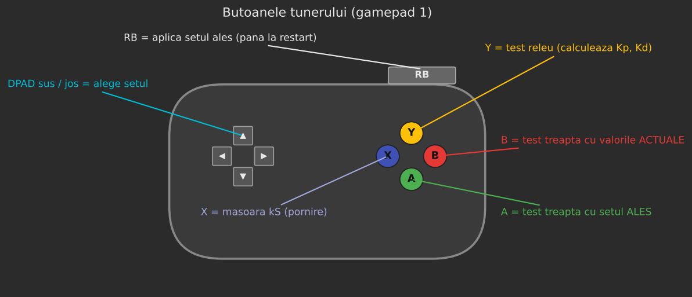
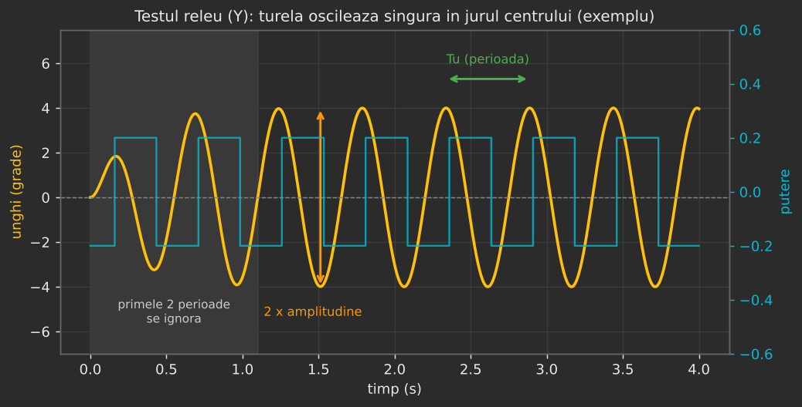
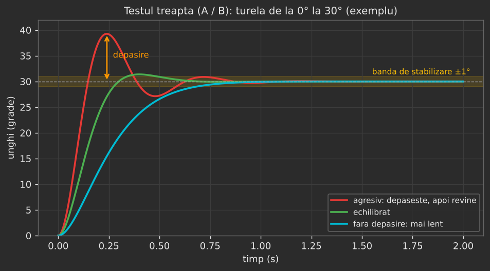

# Ghid: Turela – Auto Tuning PID

OpMode-ul **„Turela - Auto Tuning PID”** (fișierul `TurretAutoTuner.java`, grupul *Tuning* din Driver
Station) găsește singur valorile PID ale turelei:

- **`kS`**: puterea minimă la care turela pornește din loc;
- **`Kp`**: cât de tare împinge turela spre țintă;
- **`Kd`**: cât de tare frânează ca să nu treacă de țintă.

Valorile găsite merg în `TurretMotionCompensatedPID` și `TurretBallisticShotPID`. `Ki` rămâne 0, ca
până acum.

---

## 1. Înainte de START

1. **Turela împinsă cu mâna la opritorul din DREAPTA**, exact ca la autonomie. La INIT, encoderul devine
   0 acolo. Dacă turela nu era acolo, apăsați STOP, împingeți-o și dați din nou INIT.
2. **Robotul pe loc**, ridicat sau pe teren, și **nimeni cu mâna lângă turelă**. Turela se mișcă singură
   până la ±60°.
3. **Bateria încărcată.** Valorile depind de tensiune: cu bateria pe jumătate descărcată, turela pare mai
   „leneșă” și ies alte numere.
4. Apăsați **START**. Turela merge singură la centru (0°) și rămâne acolo între teste.

---

## 2. Butoanele (gamepad 1)

| Buton | Ce face |
|---|---|
| **X** | măsoară `kS` în ambele sensuri |
| **Y** | testul releu: calculează `Ku`, `Tu` și 3 seturi de `Kp` / `Kd` |
| **DPAD sus / jos** | alege unul din cele 3 seturi; cel ales are `>>` în față |
| **A** | test treaptă cu setul **ales** |
| **B** | test treaptă cu valorile **actuale** din `TurretMotionCompensatedPID`, ca să comparați |
| **RB** | aplică setul ales în ambele clase de turelă, **doar până la restartul aplicației** |

- **A** și **RB** merg doar după ce ați rulat testul releu (**Y**).
- Cât timp rulează un test, butoanele nu răspund. Așteptați până apare **„Gata”** la `Stare`.

---

## 3. Ordinea recomandată

1. **X**: măsurați `kS`. Durează câteva secunde.
2. **Y**: testul releu. Turela oscilează ~5-10 s în jurul centrului.
3. **B**: test treaptă cu valorile actuale. Notați depășirea și timpul.
4. **DPAD** pe un set, apoi **A**. Repetați pentru toate cele 3 seturi și comparați cu rezultatul de la pasul 3.
5. **RB** pe cel mai bun set.
6. **Fără să reporniți aplicația**, porniți TeleOp-ul și verificați ochirea pe teren.
7. Dacă e bine: **scrieți valorile în cod** (secțiunea 9).

---

## 4. Testul kS (butonul X)

**Ce face:**

1. Duce turela la -20°, apoi crește puterea foarte încet, cu `KS_RAMP_PER_S` = 0.05 pe secundă.
2. În momentul în care turela începe să se miște (peste `KS_MOVE_DEG_S` = 4°/s), notează puterea. Asta e
   `kS +`.
3. Face la fel în celălalt sens, de la +20°, pentru `kS -`.
4. Revine la centru.

**Rezultat:** `kS masurat: + 0.xxx / - 0.xxx -> propus 0.xxx`.

- **Propus** = 80% din cel mai mic dintre cele două. E puțin sub pragul de pornire, ca turela să nu
  tremure lângă țintă.
- Valori obișnuite: **0.03-0.15**. Dacă iese peste 0.2, turela are frecare mare (curea prea întinsă, ceva
  care freacă) și merită verificată mecanic.
- Dacă `+` și `-` diferă mult (de exemplu de două ori), într-un sens ceva freacă mai tare.

---

## 5. Testul releu (butonul Y)

**Ce face:** în jurul centrului, dă putere **+P** când turela e la dreapta de 0° și **-P** când e la
stânga.

- Turela trece de 0°, comută, revine, trece iar, adică **oscilează singură**, cu o amplitudine și o
  perioadă care țin doar de motor, curea și greutatea capului.
- `P` = `RELAY_POWER` (0.20). Dacă ați măsurat `kS` înainte, `P` devine automat cel puțin 1.5 × `kS`,
  ca să învingă frecarea.
- Primele 2 perioade se ignoră, pentru că oscilația încă se formează. Se mediază următoarele.

**Ce calculează:**

| Mărime | Formula | Ce e |
|---|---|---|
| `a` | jumătate din distanța dintre vârfuri (grade) | amplitudinea |
| `Tu` | timpul dintre două comutări în același sens (s) | perioada |
| `Ku` | `4 · P / (π · √(a² − h²))`, `h` = histerezis 0.5° | câștigul la care PID-ul ar începe să oscileze |

Din `Ku` și `Tu` ies 3 seturi de valori:

| Set | Kp | Kd | Cum se comportă |
|---|---|---|---|
| **Agresiv** (Ziegler-Nichols PD) | 0.8 · Ku | 0.1 · Ku · Tu | cel mai rapid, dar de obicei trece de țintă |
| **Echilibrat** | 0.33 · Ku | 0.11 · Ku · Tu | depășire mică, rapid; **ales implicit** |
| **Fără depășire** | 0.2 · Ku | 0.066 · Ku · Tu | cel mai lin, cel mai lent |

---

## 6. Testul treaptă (butoanele A și B)

**Ce face:**

1. Mută turela **0° → +30° → -30° → 0°**, câte 2 secunde fiecare.
2. Folosește **același controler ca în turela reală**: profil trapezoidal (`maxVelocity`,
   `maxAcceleration`), plus `kS` și limita de putere 0.6.

**Rezultat:** `Ultimul test treapta: ales (...): depasire max X°, stabilizare Y s`.

- **Depășire max:** cât de mult a trecut turela de țintă, cea mai mare dintre cele 3 mutări.
- **Stabilizare:** după cât timp turela a intrat și **a rămas** în ±1° de țintă, tot cea mai lentă
  dintre cele 3 mutări. „NU s-a stabilizat” = în 2 secunde n-a rămas în ±1°.

**Ce înseamnă „bun” pentru ochire:**

| Rezultat | Verdict |
|---|---|
| depășire **sub 1°**, stabilizare **sub ~0.6 s** | foarte bun |
| depășire 1-2°, stabilizare sub 1 s | bun |
| depășire peste 3° sau „NU s-a stabilizat” | nu folosiți setul ăsta |

---

## 7. Telemetria

| Rând | Ce arată |
|---|---|
| `Stare` | ce face acum sau ultimul mesaj (vezi secțiunea 10) |
| `Unghi` | unghiul turelei și tick-urile encoderului |
| `Actual (MotionCompensated)` | `Kp`, `Kd`, `kS` folosite acum de TeleOp |
| `kS masurat` | `+` / `-` și valoarea propusă |
| `Releu` | `Ku`, `Tu`, amplitudinea |
| cele 3 seturi | `Kp` / `Kd` pentru fiecare; setul ales are `>>` |
| `Ultimul test treapta` | depășirea și timpul de stabilizare de la ultimul A sau B |

În timpul unui test apare un rând live (`kS`, `Releu` sau `Treapta`) cu unghiul și puterea.

---

## 8. Constantele (Panels → Configurables → TurretAutoTuner)

| Constantă | Implicit | Ce e |
|---|---|---|
| `RELAY_POWER` | 0.20 | puterea releului |
| `RELAY_HYST_DEG` | 0.5 | histerezis, ca zgomotul encoderului să nu comute releul |
| `RELAY_CYCLES` | 6 | câte perioade se măsoară |
| `RELAY_TIMEOUT_S` | 10 | timpul maxim al testului releu |
| `KS_RAMP_PER_S` | 0.05 | cât de repede crește puterea la `kS` |
| `KS_MOVE_DEG_S` | 4 | de la ce viteză se consideră că turela „s-a mișcat” |
| `STEP_DEG` | 30 | mărimea treptei |
| `STEP_TIME_S` | 2 | cât se urmărește fiecare treaptă |
| `SETTLE_BAND_DEG` | 1 | „stabilizat” = eroare sub asta |
| `SAFE_LIMIT_DEG` | 60 | peste asta orice test se oprește |
| `MAX_POWER` | 0.6 | ca în clasele turelei |

---

## 9. Cum alegeți și ce scrieți în cod

1. Comparați rezultatele cu **A** pentru fiecare set cu rezultatul de la **B** (valorile actuale).
2. Alegeți setul cu **depășire sub ~1°** și cea mai mică stabilizare. La ochire contează mai mult să nu
   treacă de țintă și să nu tremure decât să fie foarte rapid.
3. **RB**, apoi TeleOp și aruncări de probă.
4. În `TurretMotionCompensatedPID.java` **și** în `TurretBallisticShotPID.java` scrieți:

    - `Kp` = valoarea din setul ales;
    - `Kd` = valoarea din setul ales;
    - `kS` = valoarea „propus” de la `kS masurat`.

5. Build și urcați pe robot. RB nu salvează nimic: după restart se revine la valorile din cod.

**Între seturi** se poate alege și o valoare la mijloc. De exemplu, dacă „Echilibrat” depășește puțin, iar
„Fără depășire” e prea lent, luați `Kp` între ele, scrieți-l în Panels la `TurretMotionCompensatedPID` și
testați cu **B**.

---

## 10. Mesaje și probleme

| Mesaj / simptom | Ce înseamnă | Ce faceți |
|---|---|---|
| „Releu: nu a oscilat destul” | `RELAY_POWER` prea mic, turela nu învinge frecarea | rulați întâi **X**, sau creșteți `RELAY_POWER` cu 0.05 |
| „Releu OPRIT: turela a iesit din zona sigura” | oscilația a fost prea mare | scădeți `RELAY_POWER` cu 0.05 |
| `kS` arată `NaN` | turela nu s-a mișcat nici la puterea 0.5 | verificați mecanic turela și cablul motorului |
| „NU s-a stabilizat” la toate seturile | frecare mare sau `maxAcceleration` prea mic | verificați `kS`; comparați cu B |
| Turela pleacă spre opritor la START | encoderul n-a fost pus pe 0 la opritorul din dreapta | STOP, împingeți turela în dreapta, INIT |
| Turela oscilează mereu în TeleOp după RB | setul e prea agresiv | alegeți „Fără depășire” sau scădeți `Kp` |
| Valorile ies foarte diferite de la o rulare la alta | baterie diferită sau frecare care variază | rulați Y de 2-3 ori și luați media |
