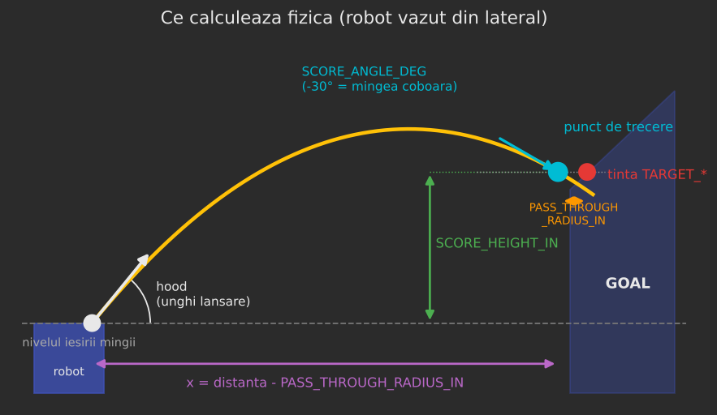
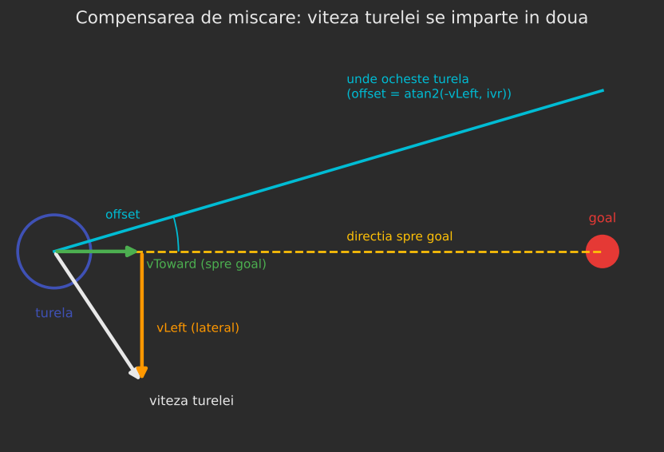
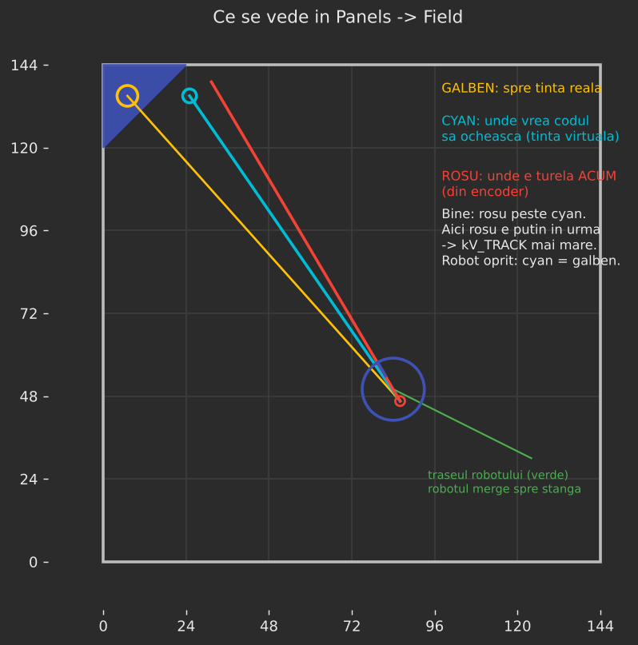
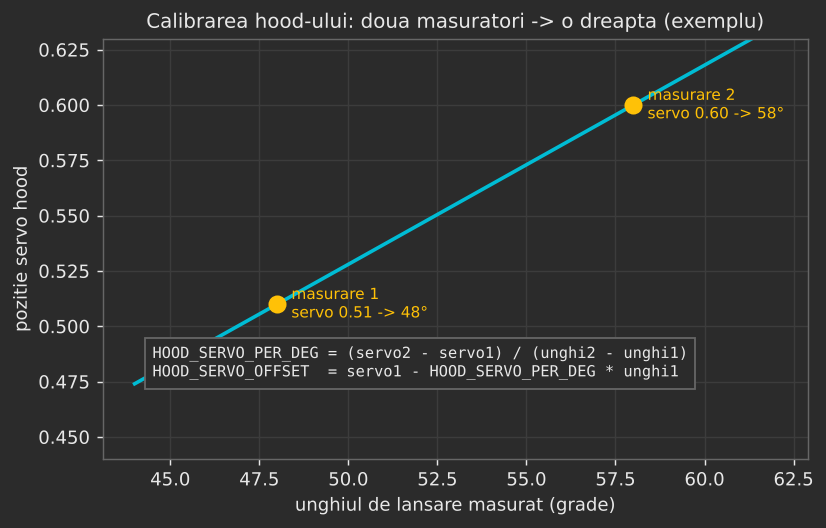

# Ghid de reglaj: TurretBallisticShotPID

Ghid pentru echipă: cum se reglează varianta de turelă care calculează aruncarea **din fizică**, nu din
tabel. Clasa: `TurretBallisticShotPID.java`.

> ⚠️ **Constantele de hood și flywheel din cod sunt ale echipei din video, NU ale robotului nostru.**
> Până nu treceți prin pașii 2 și 3, varianta asta trage greșit. E normal.

---

## 1. Pe scurt: ce face

1. **Pinpoint** (`RobotPinpoint`) dă poziția și viteza **axei turelei** pe teren, în coordonate Pedro.
2. Din distanța până la goal se calculează, cu formulele aruncării oblice:
    - **unghiul de lansare** (hood-ul);
    - **viteza mingii** la ieșirea din shooter.
3. Unghiul devine **poziție de servo**, iar viteza mingii devine **viteză de flywheel (tick/s)**, prin
   două funcții liniare. **Pe ele trebuie să le calibrați.**
4. **În mers:** viteza robotului se scade din viteza de care are nevoie mingea, iar turela ochește puțin
   în lateral. Timpul de zbor **se calculează singur**, nu se măsoară.

**Diferența față de `TurretMotionCompensatedPID`:**

| | MotionCompensatedPID (varianta 2) | BallisticShotPID (varianta 1) |
|---|---|---|
| Viteză flywheel + hood | din tabelul `ShooterDistance` | din fizică + 2 funcții liniare |
| Timp de zbor | măsurat (`TOF_*`) | calculat |
| Ce trebuie reglat | timpul de zbor, `LEAD_GAIN` | geometria, hood-ul, flywheel-ul |

### Cum o porniți

În `TeleOpAlbastru.java` și `TeleOpRosu.java`, la linia cu turela:

```java
turretMechanism = new TurretBallisticShotPID(robotPinpoint, ct2); // varianta 1: fizica
```

Restul rămâne la fel. `Shooter` vede că turela dă lovitura direct (`HasDirectShot()`) și ia viteza
flywheel-ului și hood-ul de la ea, fără tabel.

- Modul `isLong` din `Shooter` folosește în continuare tabelul.
- `Shooter.DISTANCE_CORRECTION_CM` **nu are efect** în varianta asta.

---

## 2. Ce calculează



Toate distanțele sunt în **inch**, vitezele în **inch/s**, gravitația `g = 386.09 in/s²`.

| Mărime | Formula | Ce e |
|---|---|---|
| `d` | distanța axa turelei → `TARGET_*` | din Pinpoint |
| `x` | `d - PASS_THROUGH_RADIUS_IN` | distanța orizontală până la punctul de trecere |
| `y` | `SCORE_HEIGHT_IN` | cât de sus e punctul de trecere față de ieșirea mingii |
| `a` | `SCORE_ANGLE_DEG` | unghiul cu care intră mingea în goal |
| hood `θ` | `atan(2y/x - tan a)`, limitat la `HOOD_MIN_DEG`…`HOOD_MAX_DEG` | unghiul de lansare |
| viteza `v` | `√( g·x² / (2·cos²θ·(x·tanθ - y)) )` | viteza mingii la ieșire |
| timp `t` | `x / (v·cosθ)` | timpul de zbor |
| servo | `HOOD_SERVO_PER_DEG · θ + HOOD_SERVO_OFFSET` | poziția servo-ului de hood |
| flywheel | `FLY_TICKS_PER_IN_S · v + FLY_OFFSET` | tick/s pentru motor |

- **Hood-ul:** formula dă unghiul care face mingea să treacă prin punctul de trecere **exact cu unghiul
  `a`**. Dacă hood-ul nu poate face unghiul ăla, se folosește limita, iar viteza se recalculează pentru
  unghiul de la limită.
- **Când nu există soluție:** dacă `x·tanθ ≤ y`, pe direcția aia mingea nu poate ajunge la înălțimea
  `y`. Telemetria arată **„Solutie: NU”** și se păstrează ultima lovitură bună.

**Exemplu cu valorile de acum din cod**, cele din video, deci necalibrate:

| Distanță | Hood | Viteză minge | Timp zbor | Flywheel | Servo hood |
|---|---|---|---|---|---|
| 120 cm | 61.1° | 4.34 m/s | 0.51 s | 1158 | 0.60 *(limită)* |
| 180 cm | 53.8° | 4.92 m/s | 0.58 s | 1337 | 0.51 *(limită)* |
| 240 cm | 49.2° | 5.48 m/s | 0.63 s | 1512 | 0.51 *(limită)* |
| 300 cm | 46.0° | 6.02 m/s | 0.69 s | 1600 *(limită)* | 0.51 *(limită)* |
| 375 cm | 45.0° | 6.59 m/s | 0.78 s | 1600 *(limită)* | 0.51 *(limită)* |

Servo-ul stă aproape tot timpul lipit de limite. Asta arată clar că `HOOD_SERVO_*` trebuie calibrate pe
hood-ul nostru.

---

## 3. Compensarea de mișcare



Când axa turelei merge cu cel puțin `MIN_SPEED_IN_S` (3 in/s):

1. Viteza turelei se împarte în două componente:
    - `vToward`: spre goal;
    - `vLeft`: lateral, perpendicular pe direcția spre goal.
2. **`vToward`:** mingea primește deja viteza robotului spre goal, deci shooter-ul trebuie să-i dea mai
   puțin: `ivr = x / t - vToward`.
3. **`vLeft`:** ca să anuleze deriva laterală, mingea trebuie să plece puțin înclinat în sens invers.
    - Viteza orizontală totală devine `nvr = √(ivr² + vLeft²)`.
    - Turela se rotește cu `offset = atan2(-vLeft, ivr)`.
4. Hood-ul și viteza mingii se recalculează pentru noua viteză orizontală, păstrând aceeași viteză pe
   verticală și același timp de zbor.

**Aici nu există `LEAD_GAIN` sau timp de zbor de măsurat.** Dacă hood-ul și flywheel-ul sunt calibrate
bine, compensarea iese corectă singură.

---

## 4. Toate constantele

Se schimbă **live** din **Panels** (`http://192.168.43.1:8001`) → **Configurables** →
**TurretBallisticShotPID**.

> ⚠️ Ce schimbați în Panels **se pierde la restart**. Valorile bune se scriu în
> `TurretBallisticShotPID.java`.

### Geometrie: se măsoară (pasul 1)

| Constantă | Acum | Ce e |
|---|---|---|
| `SCORE_HEIGHT_IN` | 26.0 | înălțimea punctului de trecere **minus** înălțimea de ieșire a mingii |
| `PASS_THROUGH_RADIUS_IN` | 5.0 | cât de departe, pe orizontală, e punctul de trecere **înaintea** țintei `TARGET_*` |
| `SCORE_ANGLE_DEG` | -30 | unghiul de intrare. Mai negativ = mingea cade mai abrupt |
| `G_IN_S2` | 386.09 | gravitația, **nu se schimbă** |

### Hood: se calibrează (pasul 2)

| Constantă | Acum | Ce e |
|---|---|---|
| `HOOD_SERVO_PER_DEG` | 0.0226 | cât se mișcă servo-ul pe grad. **Din video** |
| `HOOD_SERVO_OFFSET` | -0.7443 | poziția servo la 0°. **Din video** |
| `HOOD_SERVO_MIN` / `MAX` | 0.51 / 0.60 | limitele servo-ului, aceleași ca în tabel |
| `HOOD_MIN_DEG` / `MAX_DEG` | 45 / 65 | ce unghiuri poate face hood-ul. **Se măsoară** |

### Flywheel: se calibrează (pasul 3)

| Constantă | Acum | Ce e |
|---|---|---|
| `FLY_TICKS_PER_IN_S` | 7.875 | tick/s pe fiecare inch/s de viteză a mingii. **Din video** |
| `FLY_OFFSET` | -187.96 | **Din video** |
| `FLY_MIN` / `FLY_MAX` | 1100 / 1600 | limitele, aceleași ca în tabel |

### Mișcare

| Constantă | Acum | Ce e |
|---|---|---|
| `COMPENSARE_MISCARE` | true | `false` = fără compensare, ca să comparați |
| `MIN_SPEED_IN_S` | 3.0 | sub viteza asta robotul e considerat oprit |

### Turela: nu se mai ating

Sunt aceleași valori ca la celelalte variante, deja reglate:

- `TICKS_PER_DEGREE = 5.1`, `TICKS_AT_CENTER = 459`;
- `Kp = 0.032`, `Kd = 0.005`, `maxAcceleration = 200`, viteză maximă 0.6;
- deadzone-urile și toleranțele.

`TURRET_ZERO_HEADING_DEG` se atinge doar dacă trage constant stânga sau dreapta (vezi pasul 4).

---

## 5. Pasul 0: verificări (o dată pe sesiune)

1. **Encoderul turelei:** capul împins la opritorul din dreapta, apoi INIT la autonomie.
2. **Poziția Pinpoint:** porniți din autonomie sau faceți reset (bumper stânga, gamepad 2) la poziția de
   start. În Panels → Field, robotul desenat trebuie să stea unde e și pe teren.
3. **Robot oprit:** linia roșie (turela) peste cea cyan (unde vrea codul să ochească).



---

## 6. Pasul 1: geometria (cu ruleta)

Vă trebuie: ruletă și terenul. Măsurați în **inch**; cm / 2.54 = inch.

1. **Înălțimea de ieșire a mingii** `h_iesire`: de la podea până la centrul mingii, exact când iese din
   shooter. Turela stă drept; robotul pe podea.
2. **Înălțimea punctului de trecere** `h_goal`: de la podea până la locul prin care vreți să treacă
   mingea. De obicei e chiar deasupra buzei de jos a deschiderii goal-ului, cu o jumătate de minge
   (~2.5") peste ea, ca să nu atingă marginea.
3. Calculați **`SCORE_HEIGHT_IN = h_goal - h_iesire`**.
4. **`PASS_THROUGH_RADIUS_IN`:** distanța pe orizontală dintre punctul de trecere (marginea deschiderii)
   și ținta din `RobotPinpoint` (`TARGET_BLUE_X/Y` = 7, 135, respectiv `TARGET_RED_X/Y` = 135, 137).
    - Măsurați pe teren de la colț, apoi convertiți în coordonatele Pedro: colțul goal-ului albastru e
      la (0, 144), al celui roșu la (144, 144).
5. **`SCORE_ANGLE_DEG`:** porniți cu -30.
    - **Mai negativ** (-40, -45): mingea vine mai „de sus”, cu hood mai înalt și viteză mai mică.
    - **Mai puțin negativ** (-20): traiectorie mai plată și mai rapidă.

---

## 7. Pasul 2: hood-ul



**Scopul:** să aflați ce unghi de lansare face hood-ul la fiecare poziție de servo.

1. Puneți servo-ul pe **`HOOD_SERVO_MIN` (0.51)**. Din `ShooterTuning` sau dintr-un OpMode de test cu
   servo, oricare e mai la îndemână.
2. **Măsurați unghiul de lansare**, adică unghiul față de orizontală al ultimei porțiuni din hood, pe
   unde iese mingea. Ori una, ori alta:
    - **Telefon cu aplicație de nivel / înclinometru** (ex. „Measure” pe iPhone, „Bubble Level” pe
      Android), lipit de suprafața de ieșire a hood-ului.
    - **Video din lateral** al unei aruncări: unghiul primelor 3-4 cadre ale traiectoriei, măsurat pe
      ecran cu un raportor sau cu orice editor de imagini.
3. Repetați la **`HOOD_SERVO_MAX` (0.60)**.
4. Calculați:

    - `HOOD_SERVO_PER_DEG = (servo2 - servo1) / (unghi2 - unghi1)`
    - `HOOD_SERVO_OFFSET = servo1 - HOOD_SERVO_PER_DEG * unghi1`

5. **`HOOD_MIN_DEG`** = cel mai mic dintre cele două unghiuri, **`HOOD_MAX_DEG`** = cel mai mare.
   Așa fizica nu cere niciodată un unghi pe care hood-ul nu-l poate face.

> **Semnul contează.** Dacă servo-ul mai mare dă un unghi **mai mic**, `HOOD_SERVO_PER_DEG` iese
> **negativ**. E corect așa; nu-l faceți pozitiv. În tabelul vostru, servo-ul crește cu distanța, iar
> fizic, la distanță mai mare trebuie unghi mai mic. Deci la voi semnul probabil chiar iese negativ.

**Verificare:** cu robotul la diferite distanțe, telemetria arată `Hood: X° -> servo Y`. Servo-ul nu
trebuie să mai stea mereu pe 0.51 sau 0.60.

---

## 8. Pasul 3: flywheel-ul

**Scopul:** legătura dintre viteza mingii (inch/s) și viteza flywheel-ului (tick/s).

### Varianta A (recomandată): din tabelul vostru

Tabelul `ShooterDistance` are deja 18 distanțe reglate pe robot. Codul le transformă singur:

- pentru fiecare rând, hood-ul (servo → grade, cu calibrarea de la pasul 2);
- viteza mingii din fizică;
- o dreaptă **tick/s ↔ viteză minge** prin toate punctele.

1. **După** pasul 2, porniți TeleOp-ul cu varianta asta.
2. În telemetrie, la **„Sugestie din tabel”**, apare:
   `FLY_TICKS_PER_IN_S=… FLY_OFFSET=… (N pct)`.
3. Scrieți cele două valori în Panels și apoi în cod.

`N` ar trebui să fie aproape de 18. Dacă e mult mai mic, multe rânduri n-au soluție fizică: verificați
`SCORE_HEIGHT_IN` și calibrarea hood-ului.

### Varianta B: manual, din aruncări

1. Robot oprit, la ~150 cm. Ajustați `FLY_OFFSET` până intră mingea. Notați **„Viteza minge”** (in/s) și
   tick/s din telemetrie.
2. La fel la ~330 cm.
3. Calculați:

    - `FLY_TICKS_PER_IN_S = (tick2 - tick1) / (v2 - v1)`
    - `FLY_OFFSET = tick1 - FLY_TICKS_PER_IN_S * v1`

---

## 9. Pasul 4: aruncări de pe loc

Robot **oprit**, turela pe AUTO. Câte 3 aruncări la 3 distanțe: aproape (~130 cm), mijloc (~230 cm),
departe (~350 cm).

| Ce vedeți | Ce schimbați |
|---|---|
| Prea scurt **la toate** distanțele | `FLY_OFFSET` +20 |
| Prea lung la toate | `FLY_OFFSET` -20 |
| Bine aproape, scurt departe | `FLY_TICKS_PER_IN_S` +0.2 |
| Bine aproape, lung departe | `FLY_TICKS_PER_IN_S` -0.2 |
| Lovește buza de sus / sare peste | `SCORE_HEIGHT_IN` -1, sau `SCORE_ANGLE_DEG` mai negativ cu 5 |
| Lovește buza de jos | `SCORE_HEIGHT_IN` +1 |
| Constant stânga sau dreapta | `TARGET_*` în `RobotPinpoint`, apoi `TURRET_ZERO_HEADING_DEG` (±1°) |
| „Solutie: NU” la unele distanțe | `HOOD_MIN_DEG` / `MAX_DEG` prea strânse, sau `SCORE_ANGLE_DEG` prea abrupt |

Schimbați **o singură constantă odată** și refaceți toate cele 3 distanțe.

---

## 10. Pasul 5: aruncări în mers

1. Mergeți constant, cu viteză medie, **pe lângă** goal (lateral față de el) și aruncați.
2. Apoi **spre** goal și **dinspre** goal.
3. Comparați cu `COMPENSARE_MISCARE = false`, ca să vedeți că ajută.

| Ce vedeți | Cauza probabilă |
|---|---|
| Pe lateral, mingea cade **în urma** mișcării | flywheel-ul calibrat greșit (viteza reală a mingii ≠ cea calculată) |
| Spre / dinspre goal, mereu scurt sau lung, dar de pe loc e bine | flywheel-ul nu ajunge la turație între aruncări (vezi „flywheel gata” în telemetrie) |
| Turela întârzie față de linia cyan | turela nu ține pasul; aruncați mai încet |

> Varianta asta presupune că mingea preia **toată** viteza robotului. Dacă după calibrare rămâne
> constant puțin în urmă, spuneți: se poate adăuga un câștig, ca `LEAD_GAIN` din varianta 2.

---

## 11. Telemetria (secțiunea TURELĂ → „Fizica”)

| Rând | Ce arată |
|---|---|
| `Solutie` | DA = s-a putut calcula. NU = se folosește ultima lovitură bună |
| `Compensare` | DA = robotul merge peste `MIN_SPEED_IN_S` și se compensează |
| `Dist / x` | distanța până la țintă / distanța orizontală folosită (cm) |
| `Hood` | unghiul calculat → poziția servo |
| `Viteza minge` | in/s și m/s → tick/s pentru flywheel |
| `Offset miscare` | cu cât ochește turela în lateral din cauza mișcării |
| `Sugestie din tabel` | valori propuse pentru `FLY_TICKS_PER_IN_S` / `FLY_OFFSET` (pasul 3A) |

---

## 12. Probleme frecvente

| Simptom | Cauza probabilă | Ce faceți |
|---|---|---|
| Servo-ul hood stă mereu pe 0.51 sau 0.60 | `HOOD_SERVO_*` necalibrate (încă cele din video) | pasul 2 |
| Flywheel-ul stă mereu pe 1100 sau 1600 | `FLY_*` necalibrate | pasul 3 |
| „Sugestie din tabel” lipsește | `HOOD_SERVO_PER_DEG = 0` sau sub 2 puncte valide | pasul 2, apoi `SCORE_HEIGHT_IN` |
| „Solutie: NU” des | geometrie greșită sau hood prea limitat | pasul 1, `HOOD_MIN/MAX_DEG` |
| Robotul în Panels nu e unde e pe teren | poziție Pinpoint greșită | reset (bumper stânga, gamepad 2) |
| Robot oprit, roșu peste cyan, dar trage strâmb | zero-ul turelei / ținta | `TURRET_ZERO_HEADING_DEG` (±1°) sau `TARGET_*` |
| `DISTANCE_CORRECTION_CM` nu face nimic | normal: în varianta asta nu se folosește | reglați `FLY_OFFSET` |

---

## 13. La final

1. Scrieți valorile găsite în `TurretBallisticShotPID.java`: `SCORE_HEIGHT_IN`, `PASS_THROUGH_RADIUS_IN`,
   `SCORE_ANGLE_DEG`, `HOOD_*`, `FLY_*`.
2. Build, apoi urcați pe robot.
3. Comparați cu `TurretMotionCompensatedPID` (varianta 2), de pe loc și în mers.
4. Păstrați varianta care merge mai bine. Pe cealaltă o puteți șterge: clasele sunt independente.
