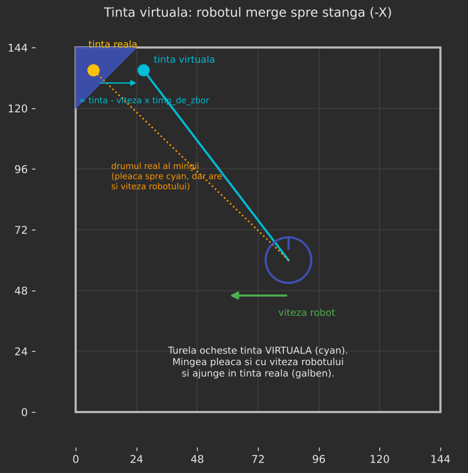
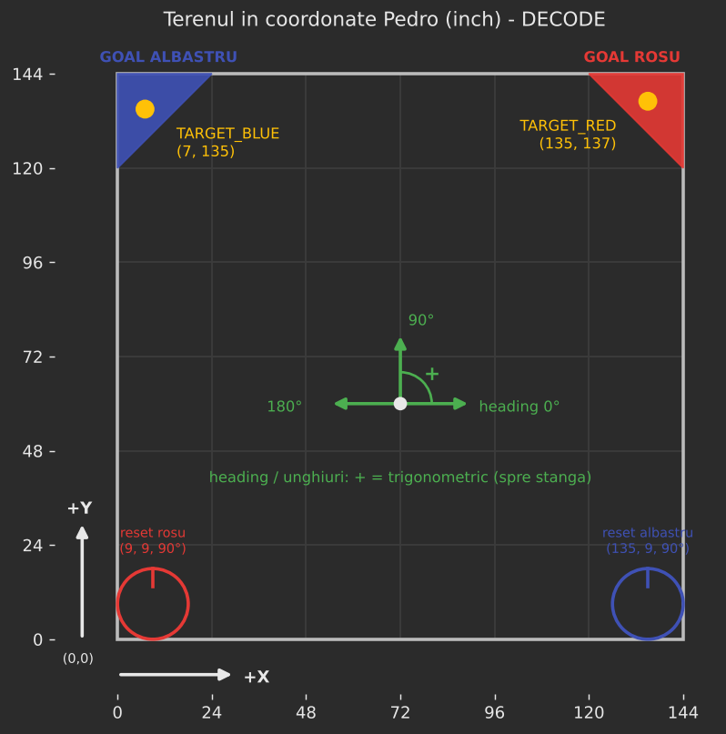
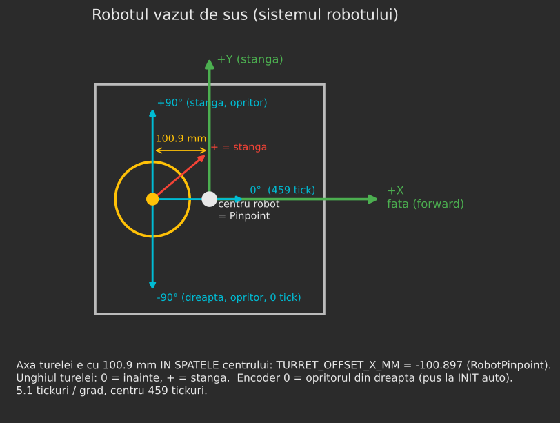
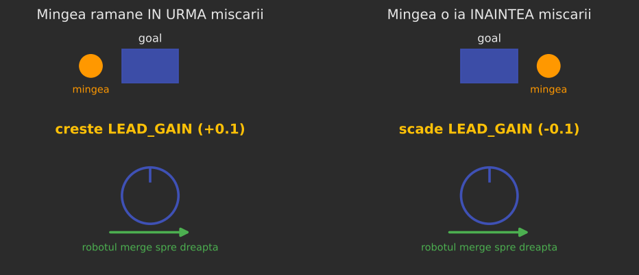

# Ghid de reglaj: TurretMotionCompensatedPID

Ghid pentru echipă: cum se reglează turela care aruncă **și în timp ce robotul se mișcă**.
Clasa: `TurretMotionCompensatedPID.java`. Folosită de `TeleOpAlbastru` și `TeleOpRosu`
când `ARUNCARE_FIZICA = false`, adică implicit.

---

## 1. Pe scurt: ce face

1. **Pinpoint** (`RobotPinpoint`) dă poziția robotului, heading-ul și viteza, în coordonate Pedro.
2. Din ele se calculează unde e **axa turelei** pe teren. Axa e cu 100.9 mm în spatele centrului.
3. **Robot oprit:** turela ochește direct ținta (goal-ul).
4. **Robot în mișcare:** mingea pleacă din shooter și cu viteza robotului, deci „derivează” cât timp e
   în aer. Turela ochește o **țintă virtuală**, mutată invers față de mișcare:

   `tinta_virtuala = tinta - viteza_turelei * timp_de_zbor`

5. Distanța până la ținta virtuală merge în **Shooter** (tabelul `ShooterDistance`), deci viteza
   flywheel-ului și hood-ul se adaptează și ele la mișcare.

---

## 2. Coordonatele (format Pedro)

- Terenul are **0 … 144 inch** pe X și pe Y. Punctul **(0, 0)** e colțul din stânga-jos.
- **Goal albastru** în stânga-sus, **goal roșu** în dreapta-sus.
- **Heading:** 0° = spre +X (dreapta), 90° = spre +Y (sus). Unghi pozitiv = trigonometric (spre stânga).
- Punctul spre care ochește turela e definit în `RobotPinpoint.java`:

| Constantă | Valoare acum | Ce e |
|---|---|---|
| `TARGET_BLUE_X`, `TARGET_BLUE_Y` | 7, 135 | ținta albastră |
| `TARGET_RED_X`, `TARGET_RED_Y` | 135, 137 | ținta roșie |
| `TURRET_OFFSET_X_MM` | -100.897 | axa turelei e în spatele centrului |
| `TURRET_OFFSET_Y_MM` | 0 | axa turelei e pe mijloc stânga-dreapta |

- **Reset poziție (RT pe gamepad 2):** albastru (135, 9, 90°), roșu (9, 9, 90°). Robotul trebuie să fie
  **exact** acolo și orientat exact așa când apăsați, altfel tot ce urmează iese greșit.

---

## 3. Unde se reglează

Toate constantele `public static` se pot schimba **live**, fără să reîncărcați codul:

1. Conectați-vă la WiFi-ul robotului și deschideți **Panels**: `http://192.168.43.1:8001`.
2. Tab-ul **Configurables** → **TurretMotionCompensatedPID**.
3. Schimbați valoarea. Se aplică imediat, în TeleOp-ul care rulează.

> ⚠️ Ce schimbați în Panels **se pierde la restart**. Când găsiți valorile bune,
> **scrieți-le în `TurretMotionCompensatedPID.java`**.

Pe ecranul Driver Hub, primele rânduri sunt:

- **PINPOINT:** X, Y, Heading, Dist goal, Unghi goal, Viteza.
- **TURELĂ:** Unghi, Țintă, Eroare, Compensare, Viteza turelă, Timp zbor, Țintă virtuală, Dist. aruncare.

În Panels → tab-ul **Field** se vede robotul pe teren și trei linii:

| Linie | Ce arată |
|---|---|
| **Galben** | spre ținta reală |
| **Cyan** | unde **vrea codul** să ochească (ținta virtuală). Robot oprit → cyan = galben |
| **Roșu** | unde e turela **acum**, după encoder |

**Corect:** linia roșie stă peste cea cyan.

---

## 4. Înainte de reglaj: verificări (o dată pe sesiune)

Dacă unul dintre punctele astea nu e în regulă, reglajul de mai jos nu are sens.

1. **Encoderul turelei:** capul împins la **opritorul din dreapta**, apoi INIT la autonomie. Acolo
   encoderul devine 0.
2. **Poziția Pinpoint:** rulați autonomia înainte de TeleOp, sau faceți reset cu RT la poziția de start.

    - Verificare: robotul desenat în Panels trebuie să stea unde e și pe teren.

3. **Robot oprit, baza spre goal:** după ce se oprește turela, **Eroare** sub ~1° și linia roșie peste
   cea galbenă.
4. **Aruncări de pe loc**, din 2-3 locuri:

    - mingea iese constant **stânga sau dreapta** → verificați `TARGET_*`, apoi `TURRET_ZERO_HEADING_DEG`
      (câte 1°);
    - mingea iese constant **prea scurt sau prea lung** → `DISTANCE_CORRECTION_CM` în `Shooter`
      (câte 5 cm).

Constantele turelei care **nu se mai ating** (sunt deja calibrate):
`TICKS_PER_DEGREE = 5.1`, `TICKS_AT_CENTER = 459`, `Kp = 0.032`, `Kd = 0.005`,
`maxAcceleration = 200`, viteză maximă 0.6, deadzone-urile și toleranțele.

---

## 5. Pasul 1: timpul de zbor (cel mai important)

Acum valorile sunt **estimate**: 0.35 s la 120 cm și 0.75 s la 375 cm. Trebuie măsurate.

**Ce vă trebuie:** un telefon care filmează în **slow-motion (240 fps)** sau măcar la **60 fps**.

1. Robotul **oprit**, turela pe AUTO, cât mai **aproape** de goal (distanța minimă de la care aruncați).
2. Citiți **„Dist. aruncare”** din telemetrie (cm). Valoarea merge în `TOF_NEAR_CM`.
3. Filmați aruncarea **din lateral** (perpendicular pe traiectorie), cu telefonul fix. În cadru trebuie
   să intre și **ieșirea mingii din shooter**, și **goal-ul**.
4. Pe calculator, în **VLC** (tasta **E** = un cadru înainte), numărați cadrele de la cadrul în care
   mingea iese din shooter până la cadrul în care intră în goal.
5. **Timp de zbor = număr de cadre / fps-ul de FILMARE.**

    - ⚠️ La slow-motion împărțiți la **240**, nu la 30, care e viteza de redare. E greșeala cea mai des
      întâlnită.
    - Exemplu: 96 de cadre la 240 fps = 0.40 s. Valoarea merge în `TOF_NEAR_S`.

6. Repetați de la **cea mai mare** distanță de la care aruncați, pentru `TOF_FAR_CM` și `TOF_FAR_S`.
7. Faceți 2-3 aruncări la fiecare distanță și luați **media**.

> Nu trimiteți videoclipurile pe WhatsApp dacă vreți să le numere altcineva: WhatsApp scade numărul de
> cadre pe secundă. Trimiteți-le ca fișier.

Între cele două distanțe, timpul de zbor se calculează **liniar**. Sub prima distanță se folosește
`TOF_NEAR_S`, peste a doua `TOF_FAR_S`.

---

## 6. Pasul 2: `LEAD_GAIN` (aruncări în mers)

`LEAD_GAIN` = cât de mult se compensează. 1.0 = teoretic.

1. Mergeți **constant**, cu viteză medie, **pe lângă** goal (stânga-dreapta față de el) și aruncați în
   timpul mișcării.
2. Uitați-vă unde cade mingea **față de direcția de mers**:

| Mingea cade… | Ce faceți |
|---|---|
| **în urma** mișcării (mergeți spre dreapta, mingea cade în stânga goal-ului) | `LEAD_GAIN` **+0.1** |
| **înaintea** mișcării | `LEAD_GAIN` **-0.1** |
| în goal | gata |

3. Dacă timpul de zbor e măsurat bine, `LEAD_GAIN` ar trebui să rămână între **0.9 și 1.1**. Dacă vă
   trebuie mult mai mult sau mult mai puțin, refaceți pasul 1.
4. Încercați apoi și **spre goal / dinspre goal**. Acolo greșește distanța (prea scurt / prea lung).
   Dacă în mers e mereu prea scurt sau prea lung, dar pe loc e bine, tot timpul de zbor e de vină.

---

## 7. Pasul 3: `kV_TRACK` (doar dacă turela rămâne în urmă)

Când robotul merge sau se rotește, ținta se mută continuu. Dacă turela nu ține pasul, o ajută
`kV_TRACK`, un feedforward care adaugă putere proporțional cu cât de repede se mută ținta.

1. Panels → **Field**. Mergeți și rotiți robotul.
2. Linia **roșie** întârzie după cea **cyan** → creșteți `kV_TRACK` cu câte **0.0005**.
3. Vă opriți când roșia urmărește cyan fără să o ia înainte.
4. Dacă turela începe să **oscileze** sau o ia înainte → reveniți la valoarea anterioară.

Pornește de la **0**, adică doar PID, cum era înainte.

---

## 8. Constante opționale

| Constantă | Implicit | Când o schimbați |
|---|---|---|
| `COMPENSARE_ACTIVA` | true | `false` = fără compensare, ca să comparați |
| `MIN_SPEED_IN_S` | 3.0 | sub viteza asta robotul e considerat oprit. Creșteți dacă ținta virtuală „tremură” cu robotul oprit |
| `LATENCY_S` | 0.0 | doar dacă după pașii 1-3, la viteză mare, mingea tot rămâne puțin în urmă: încercați 0.05-0.1 |
| `ITERATII` | 3 | nu se schimbă |
| `TRACK_FILTER` | 0.3 | netezirea pentru `kV_TRACK`. Mai mic = mai lin, dar mai lent |
| `TRACK_MIN_RATE_DEG_S` | 5.0 | sub viteza asta a țintei, `kV_TRACK` nu se aplică |

---

## 9. Probleme frecvente

| Simptom | Cauza probabilă | Ce faceți |
|---|---|---|
| Robotul în Panels nu e unde e pe teren | poziție Pinpoint greșită | reset cu RT la poziția de start, sau porniți din autonomie |
| Robot oprit, „Eroare” rămâne mare (>2°) | frecare / PID | `kS` mic (0.02-0.05) în TurretMotionCompensatedPID |
| Robot oprit, roșu peste galben, dar trage strâmb | zero-ul turelei / punctul țintă | `TURRET_ZERO_HEADING_DEG` (±1°) sau `TARGET_*` |
| Robot oprit, prea scurt / prea lung | tabelul de distanțe | `Shooter.DISTANCE_CORRECTION_CM` |
| „Compensare: nu” deși robotul merge | viteză sub `MIN_SPEED_IN_S` | normal la mers foarte încet |
| În mers, mingea mereu în urma mișcării | timp de zbor prea mic / `LEAD_GAIN` mic | pasul 1, apoi pasul 2 |
| În mers, turela întârzie (roșu după cyan) | lipsă feedforward | pasul 3 (`kV_TRACK`) |
| Ultimele mingi dintr-o rafală ies prea scurt sau prea lung | viteza și hood-ul se fixează la apăsarea butonului | aruncați la viteză constantă; limită cunoscută |

---

## 10. La final

1. Scrieți valorile găsite în `TurretMotionCompensatedPID.java`
   (`TOF_NEAR_CM`, `TOF_NEAR_S`, `TOF_FAR_CM`, `TOF_FAR_S`, `LEAD_GAIN`, `kV_TRACK`…).
2. Build, apoi urcați pe robot.
3. Verificați o dată, de pe loc și în mers, că se comportă ca în Panels.
